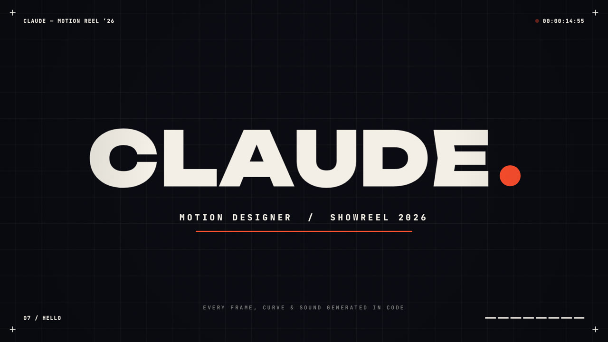

# CLAUDE — Motion Reel 2026

A 15-second, 1080p60 motion design showreel where **every frame, curve and sound is generated in code**. It uses no After Effects, no stock footage and no samples.



**▶ [showreel.mp4](showreel.mp4)** · 1920×1080 · 60 fps · H.264 + AAC · 15.000 s

## The cut

The whole piece sits on one beat grid: 128 BPM, 8 bars, which comes to exactly 15 seconds. Every cut, impact and wipe lands on a beat, and the synthesized soundtrack is driven by the same clock as the picture.

| Bar | Time | Chapter | What it shows |
|----|------|---------|---------------|
| 0 | 0.00 | **Intro** | A HUD-style crosshair builds around a coral dot, followed by shock rings, orbiters with trails and a decoding title. Then the camera dives into the dot. |
| 1 | 1.88 | **Kinetic Type** | “I MAKE / THINGS” uses masked slide-ups and pop-and-twist letters. A whip-off leads into the **MOVE** slam: a 9-layer extruded echo stack with overlapping, follow-through letter jumps. The scene exits through a venetian-blind wipe. |
| 2 | 3.75 | **Rhythm & Grids** | 153 parametric shapes pulse in beat-synced ripples, each wave changing colour and adding a 90° turn. Plus signs morph to squares and then to circles. The centre cell match-cuts into… |
| 3 | 5.63 | **Dimension** | …a 1,496-point 3D sphere that morphs into a torus, with an orbit ring, kick-driven ripples, a live technical callout and a fly-through. |
| 4 | 7.50 | **Liquid Surfaces** | Glossy metaballs shaded per pixel with normals, specular, fresnel and rim light. They sit over outline marquee type, with a difference-blended headline. The blobs merge into one drop that floods the frame. |
| 5 | 9.38 | **Product UI** | A dashboard with staggered cards, a counting KPI, overshooting bars, a self-drawing spline chart, a donut sweep, and a cursor that clicks squash-and-stretch toggles on the beat. A whip pan carries the cut into… |
| 6 | 11.25 | **Chaos Edit** | A half-beat montage: FAST, a halftone ripple, an RGB-split glitch sphere, op-art stripes, a spiral tunnel and LOUD. The lines converge and the screen drops to black for the gap before the hit. |
| 7 | 13.13 | **Hello** | The impact flash, shockwave and debris. The wordmark springs in letter by letter, then the dot from frame one drops in as the full stop and bounces with real ballistic physics plus squash and stretch. The letters ripple from each impact and a specular sweep crosses the wordmark. |

### Craft details
- **Real motion blur.** Each output frame averages 10–48 sub-frames over a 180° shutter, with the count adapting to how fast things move. Blur never integrates across a hard cut.
- **Physics, not keyframes.** It uses damped springs, ballistic bounces with restitution, and analytic trails.
- **Finishing.** The frame gets film grain, a vignette, camera shake keyed to the kick drum, a 1.2% kick zoom pulse, and a HUD with SMPTE timecode, chapter roll-ups and segmented progress.
- **Sound design.** The soundtrack is synthesized with the Web Audio API: a four-on-the-floor kick, sidechain ducking, an offbeat saw bass, an F-minor arp through a dotted-eighth delay, risers, whooshes and UI blips. The six letter appearances get FM bells, and every bounce of the dot gets a "thock". The mix measures −13 LUFS with true peak below −0.7 dBFS.

## Run it

**Live in the browser.** Serve the folder and open `index.html`, then click to play with sound. Hover for a scrubber.

```sh
npx serve .            # or: python3 -m http.server
```

**Render the MP4.** This needs Node 18+, Playwright with Chromium, and ffmpeg built with libx264.

```sh
npm i -D playwright    # if not installed globally
node render.mjs                        # -> out/showreel.mp4  (≈5 min on 4 cores)
node render.mjs --stills 2.5,8,14.9    # quick PNG stills -> out/stills/
node render.mjs --samples 1            # fast draft, no motion blur
```

## Files
- `reel.js` holds the whole film: the easing and spring kit, 8 scenes, the motion blur renderer, the HUD and finishing, and the audio synth.
- `index.html` is the player shell and font loading.
- `render.mjs` handles headless frame rendering across parallel workers, the offline audio render and ffmpeg muxing.
- `fonts/` contains Unbounded, Anton, JetBrains Mono and Inter. All are SIL Open Font License 1.1, via Google Fonts.
